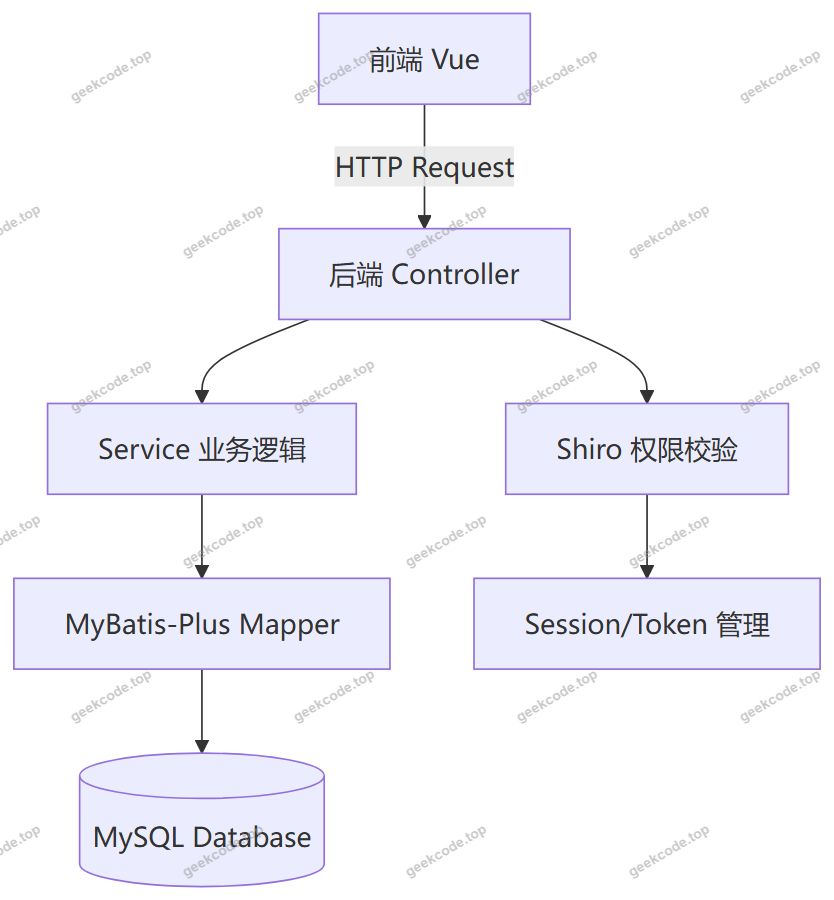
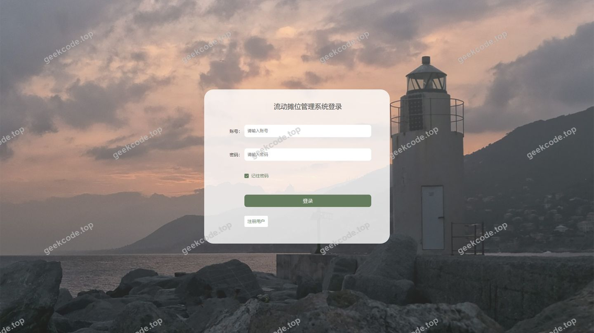
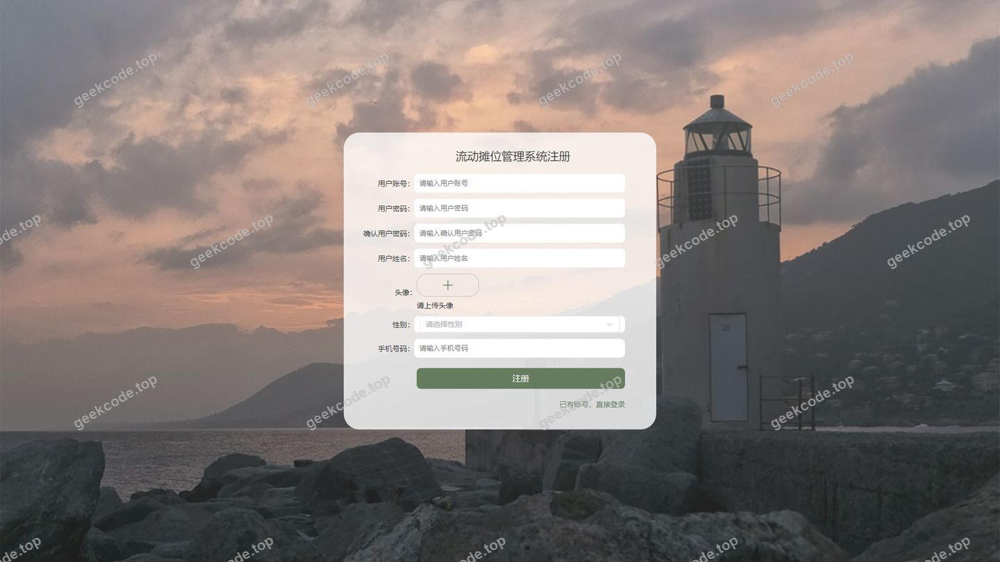
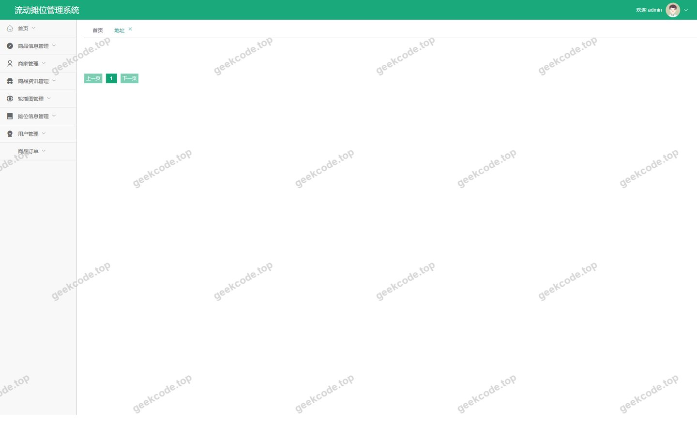
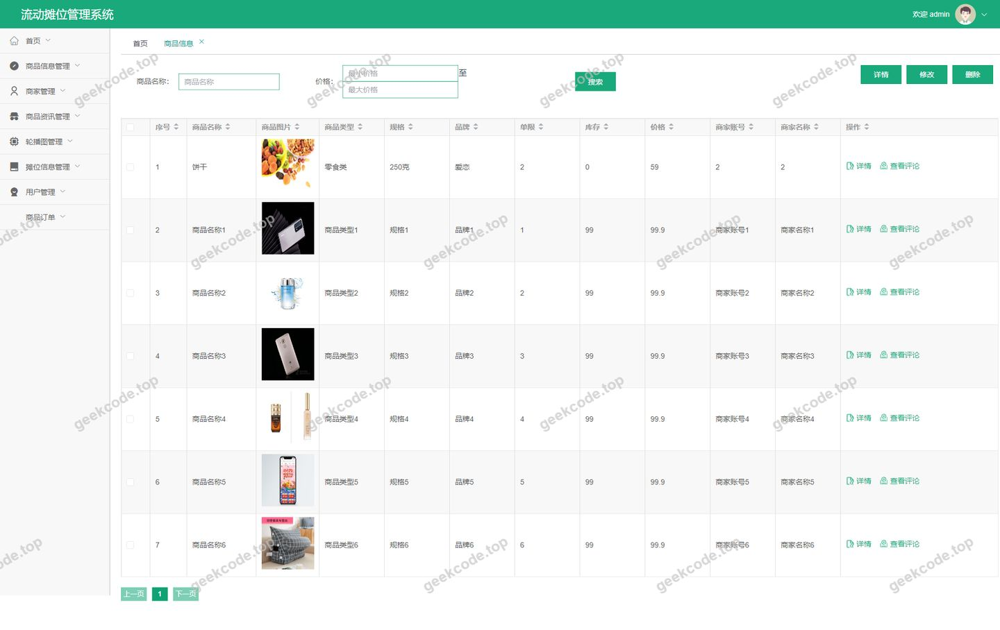
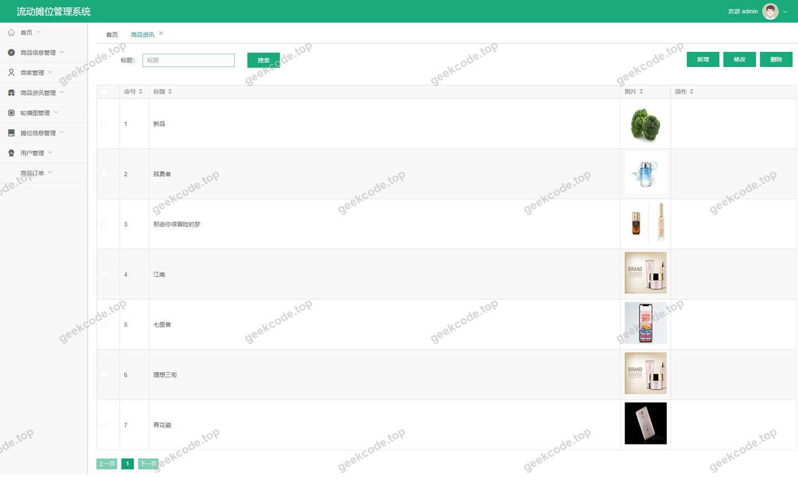

# springboot + vue 流动摊位管理系统

> 🎓 **计算机毕业设计 · springboot + vue 流动摊位管理系统**
>
> 本仓库只放**项目介绍 + 运行截图**（截图是站点带水印的原图，存在仓库 `images/` 里）。
>
> 👉 **完整可运行源码 / 数据库脚本 / 部署文档：[点我获取](https://geekcode.top/archives/springboot-vue-%E6%B5%81%E5%8A%A8%E6%91%8A%E4%BD%8D%E7%AE%A1%E7%90%86%E7%B3%BB%E7%BB%9F?utm_source=github)**
>
> 💬 咨询微信：**ir9372**　|　🌐 更多项目：[极客代码 geekcode.top](https://geekcode.top/?utm_source=github)
>
> 📌 项目详情页：<https://geekcode.top/archives/springboot-vue-%E6%B5%81%E5%8A%A8%E6%91%8A%E4%BD%8D%E7%AE%A1%E7%90%86%E7%B3%BB%E7%BB%9F?utm_source=github>

<table><td width="230" align="center"> <b>扫码加微信 ir9372</b></td><td valign="middle">📦 源码 = 项目介绍 + 全部运行截图 + 数据库 + 部署文档 👉 点上方任意截图，直接跳到 <b>极客代码 geekcode.top</b> 详情页</td></table>

---

<h1>springboot + vue 流动摊位管理系统</h1>
<h2>项目概述</h2>

本项目为基于 Spring Boot 与 Vue 技术栈构建的流动摊位管理系统，旨在解决城市流动摊贩管理中信息分散、审批流程复杂及商品销售数据不透明等问题。系统采用前后端分离架构，划分为前台用户端与后台管理端。核心功能涵盖摊位信息管理、摊位申请调整、商品上架与销售、特价商品推广、订单处理及商家入驻审核等模块。适用人群包括普通消费者（浏览商品、下单）、流动摊主/商家（管理店铺、发布商品）以及系统管理员（全局监管、基础数据维护）。通过数字化手段提升摊位资源配置效率，规范经营行为，实现从摊位申请到商品交易的全链路闭环管理。

<h2>技术架构</h2>
<h3>1. 总体架构设计</h3>

系统采用经典的前后端分离模式：

<ul>
<li><strong>前端层</strong>：基于 Vue.js 框架构建单页面应用（SPA），负责视图渲染、交互逻辑及 API 请求封装。分为面向消费者的前台界面和面向管理员/商家的后台管理界面。</li>
<li><strong>后端服务层</strong>：基于 Spring Boot 框架搭建 RESTful API 服务，处理业务逻辑、事务管理及权限控制。</li>
<li><strong>数据持久层</strong>：使用 MyBatis-Plus 作为 ORM 框架，简化数据库操作；底层数据库选用 MySQL，存储用户、摊位、商品、订单等业务数据。</li>
<li><strong>安全认证层</strong>：集成 Apache Shiro 框架，实现身份验证、授权访问控制及会话管理，确保系统安全性。</li>
</ul>
<h3>2. 核心技术选型理由</h3>
<ul>
<li><strong>Spring Boot</strong>：提供快速开发能力，内置 Tomcat 容器，简化配置，便于微服务化扩展或独立部署。</li>
<li><strong>MyBatis-Plus</strong>：在 MyBatis 基础上增强 CRUD 操作，减少样板代码，支持分页插件及乐观锁等高级特性，提升开发效率。</li>
<li><strong>Shiro</strong>：轻量级且功能强大的 Java 安全框架，相比 Spring Security 更易于上手，适合中小型项目的权限模型构建。</li>
<li><strong>Vue.js</strong>：响应式数据绑定与组件化开发模式，使得前后台界面复用率高，用户体验流畅。</li>
</ul>
<h3>3. 数据库设计要点</h3>

根据路由与截图推断，核心实体关系如下：

<ul>
<li><strong>用户体系</strong>：区分 <code>yonghu</code>（普通用户/消费者）与 <code>shangjia</code>（商家/摊主）。</li>
<li><strong>摊位管理</strong>：<code>tanweixinxi</code>（摊位基本信息）与 <code>tanweishenqingdiaozheng</code>（摊位申请与状态调整记录）。</li>
<li><strong>商品体系</strong>：<code>shangpinxinxi</code>（常规商品信息）、<code>tejiashangpin</code>（特价商品专区）、<code>shangpinleixing</code>（商品分类字典）。</li>
<li><strong>交易链路</strong>：<code>orders</code>（订单主表）、<code>address</code>（收货地址）、<code>storeup</code>（收藏/库存关联）、<code>discussshangpinxinxi</code>（商品评论）。</li>
</ul>

<h2>功能模块</h2>
<h3>1. 前台用户端（消费者视角）</h3>

主要服务于普通注册用户，提供商品浏览、搜索、购买及个人信息管理服务。

<table>
<thead>
<tr>
<th align="left">模块名称</th>
<th align="left">功能描述</th>
</tr>
</thead>
<tbody><tr>
<td align="left"><strong>首页展示</strong></td>
<td align="left">展示推荐商品、特价活动入口、最新摊位资讯及新闻公告。</td>
</tr>
<tr>
<td align="left"><strong>用户注册/登录</strong></td>
<td align="left">新用户的账号创建、密码找回及现有用户身份认证。</td>
</tr>
<tr>
<td align="left"><strong>个人中心</strong></td>
<td align="left">查看个人资料、修改密码、管理收货地址 (<code>addressList</code>)、查看我的收藏 (<code>storeupList</code>)。</td>
</tr>
<tr>
<td align="left"><strong>商品浏览</strong></td>
<td align="left">按分类 (<code>shangpinleixingList</code>) 筛选商品，查看详情 (<code>shangpinxinxiDetail</code>)，浏览特价专区 (<code>tejiashangpinList</code>)。</td>
</tr>
<tr>
<td align="left"><strong>购物车与结算</strong></td>
<td align="left">将商品加入购物车 (<code>cartList</code>)，确认订单信息 (<code>order_confirm</code>)，提交订单。</td>
</tr>
<tr>
<td align="left"><strong>订单管理</strong></td>
<td align="left">查看历史订单状态 (<code>ordersList</code>)，追踪物流或摊位配送情况。</td>
</tr>
<tr>
<td align="left"><strong>互动评论</strong></td>
<td align="left">对已购买商品进行评价 (<code>discussshangpinxinxi</code>)，参与社区讨论。</td>
</tr>
<tr>
<td align="left"><strong>摊位查询</strong></td>
<td align="left">查看公开摊位信息列表 (<code>tanweixinxiList</code>) 及详情，了解摊位位置与资质。</td>
</tr>
</tbody></table>
<h3>2. 后台管理端（管理员/商家视角）</h3>

服务于系统管理员及入驻商家，提供全量数据管理、业务审批及运营配置功能。

<table>
<thead>
<tr>
<th align="left">模块名称</th>
<th align="left">功能描述</th>
</tr>
</thead>
<tbody><tr>
<td align="left"><strong>仪表盘</strong></td>
<td align="left">展示系统关键指标概览（如待办事项、数据统计）。</td>
</tr>
<tr>
<td align="left"><strong>用户管理</strong></td>
<td align="left">管理普通用户 (<code>yonghu</code>) 信息，包括增删改查及状态管控。</td>
</tr>
<tr>
<td align="left"><strong>商家管理</strong></td>
<td align="left">审核商家入驻申请 (<code>shangjiaRegister</code>)，管理商家档案 (<code>shangjia</code>)，分配摊位资源。</td>
</tr>
<tr>
<td align="left"><strong>摊位管理</strong></td>
<td align="left">维护摊位基础信息 (<code>tanweixinxi</code>)，处理摊位申请与调整流程 (<code>tanweishenqingdiaozheng</code>)，监控摊位使用状态。</td>
</tr>
<tr>
<td align="left"><strong>商品管理</strong></td>
<td align="left">发布与管理常规商品 (<code>shangpinxinxi</code>)，设置特价商品 (<code>tejiashangpin</code>)，维护商品分类 (<code>shangpinleixing</code>)。</td>
</tr>
<tr>
<td align="left"><strong>订单管理</strong></td>
<td align="left">查看所有订单 (<code>orders</code>)，处理退款、发货及异常订单干预。</td>
</tr>
<tr>
<td align="left"><strong>内容管理</strong></td>
<td align="left">发布系统新闻 (<code>news</code>)，回复或审核用户评论 (<code>discusstejiashangpin</code>, <code>discussshangpinxinxi</code>)。</td>
</tr>
<tr>
<td align="left"><strong>系统配置</strong></td>
<td align="left">管理基础参数配置 (<code>config</code>)，如轮播图、站点信息等。</td>
</tr>
<tr>
<td align="left"><strong>地址库管理</strong></td>
<td align="left">维护通用的区域地址数据 (<code>address</code>)，供前端选择使用。</td>
</tr>
</tbody></table>
<h2>用户角色与权限</h2>

系统主要包含三类角色，其权限边界清晰划分：

<h3>1. 普通用户 (Yonghu)</h3>
<ul>
<li><strong>定位</strong>：终端消费者。</li>
<li><strong>权限范围</strong>：<ul>
<li><strong>完全访问</strong>：前台所有浏览类页面（首页、商品列表、详情、新闻）。</li>
<li><strong>操作权限</strong>：注册/登录、添加/编辑收货地址、加入购物车、提交订单、发表评论、收藏商品。</li>
<li><strong>受限访问</strong>：无法进入后台管理系统，无法管理其他用户数据，仅能查看和操作属于自己账户的数据（个人订单、个人收藏）。</li>
</ul>
</li>
</ul>
<h3>2. 商家/摊主 (Shangjia)</h3>
<ul>
<li><strong>定位</strong>：资源提供者与经营者。</li>
<li><strong>权限范围</strong>：<ul>
<li><strong>入驻权限</strong>：通过 <code>/shangjiaRegister</code> 提交入驻申请。</li>
<li><strong>摊位相关</strong>：查看所属摊位信息 (<code>tanweixinxi</code>)，发起摊位调整申请 (<code>tanweishenqingdiaozheng</code>)。</li>
<li><strong>商品运营</strong>：发布和管理自有商品 (<code>shangpinxinxiAdd/Edit</code>)，设置特价商品 (<code>tejiashangpin</code>)。</li>
<li><strong>订单处理</strong>：查看归属于本店的订单 (<code>orders</code>)，进行发货或状态更新。</li>
<li><strong>数据中心</strong>：访问 <code>/shangjiaCenter</code> 查看经营报表及消息通知。</li>
<li><strong>限制</strong>：不可删除其他商家数据，不可修改系统全局配置。</li>
</ul>
</li>
</ul>
<h3>3. 系统管理员 (Admin)</h3>
<ul>
<li><strong>定位</strong>：平台运营者与监管者。</li>
<li><strong>权限范围</strong>：<ul>
<li><strong>全局数据管理</strong>：拥有对所有实体（用户、商家、摊位、商品、订单、评论）的最高读写权限。</li>
<li><strong>审批职能</strong>：审核商家注册 (<code>shangjia</code>)，审批摊位申请调整 (<code>tanweishenqingdiaozheng</code>)。</li>
<li><strong>内容发布</strong>：发布官方新闻 (<code>news</code>)，管理商品分类 (<code>shangpinleixing</code>)。</li>
<li><strong>系统配置</strong>：修改系统参数 (<code>config</code>)，维护基础地址库 (<code>address</code>)。</li>
<li><strong>安全审计</strong>：可重置用户密码，禁用违规账号。</li>
</ul>
</li>
</ul>
<h2>项目特色与创新点</h2>
<ol>
<li>
<strong>全流程摊位生命周期管理</strong>：
不仅实现了静态的摊位信息录入，还引入了“摊位申请调整”模块 (<code>tanweishenqingdiaozheng</code>)，模拟了现实中摊位位置变更、租约调整的业务场景，增强了系统的业务贴合度。

</li>
<li>
<strong>双轨制商品营销体系</strong>：
将常规商品 (<code>shangpinxinxi</code>) 与特价商品 (<code>tejiashangpin</code>) 在数据结构和管理路由上进行了物理隔离。这种设计便于针对促销活动进行独立的流量引导和数据统计，同时也方便管理员对高风险或引流商品进行单独管控。

</li>
<li>
<strong>基于 Shiro 的精细化权限控制</strong>：
利用 Shiro 框架实现了 RBAC（基于角色的访问控制）模型。结合 Vue 前端路由守卫与后端接口注解，确保了不同角色（尤其是商家与管理员之间）的数据隔离，防止越权访问敏感商业数据。

</li>
<li>
<strong>前后端一体化的用户体验</strong>：
前台注重消费转化的便捷性（如一键加购、地址自动填充），后台注重管理效率（如批量审核、状态流转可视化）。两者共享同一套后端 API，保证了数据的一致性和实时性。

</li>
</ol>
<h2>部署环境</h2>

为确保系统正常运行，需准备以下软件环境：

<table>
<thead>
<tr>
<th align="left">组件类别</th>
<th align="left">软件名称</th>
<th align="left">建议版本</th>
<th align="left">说明</th>
</tr>
</thead>
<tbody><tr>
<td align="left"><strong>开发语言</strong></td>
<td align="left">JDK</td>
<td align="left">1.8+</td>
<td align="left">Java 运行环境，支撑 Spring Boot 后端服务。</td>
</tr>
<tr>
<td align="left"><strong>数据库</strong></td>
<td align="left">MySQL</td>
<td align="left">5.7 / 8.0</td>
<td align="left">关系型数据库，用于存储业务数据。需初始化 SQL 脚本。</td>
</tr>
<tr>
<td align="left"><strong>后端框架</strong></td>
<td align="left">Spring Boot</td>
<td align="left">2.x</td>
<td align="left">内置 Tomcat 服务器，无需额外安装 Web 容器。</td>
</tr>
<tr>
<td align="left"><strong>ORM 框架</strong></td>
<td align="left">MyBatis-Plus</td>
<td align="left">3.x</td>
<td align="left">数据库交互中间件。</td>
</tr>
<tr>
<td align="left"><strong>安全框架</strong></td>
<td align="left">Apache Shiro</td>
<td align="left">1.4+</td>
<td align="left">权限与安全控制模块。</td>
</tr>
<tr>
<td align="left"><strong>前端环境</strong></td>
<td align="left">Node.js</td>
<td align="left">12+</td>
<td align="left">用于编译 Vue 项目及运行 npm/yarn 包管理器。</td>
</tr>
<tr>
<td align="left"><strong>前端框架</strong></td>
<td align="left">Vue.js</td>
<td align="left">2.x</td>
<td align="left">前端 UI 框架。</td>
</tr>
<tr>
<td align="left"><strong>构建工具</strong></td>
<td align="left">Maven</td>
<td align="left">3.6+</td>
<td align="left">后端依赖管理与打包工具。</td>
</tr>
</tbody></table>

<strong>部署步骤简述：</strong>

<ol>
<li>安装并启动 MySQL 服务，导入项目提供的 <code>.sql</code> 数据库文件。</li>
<li>修改后端 <code>application.yml</code> 配置文件中的数据库连接 URL、用户名和密码。</li>
<li>使用 Maven 命令 <code>mvn clean package</code> 打包后端 jar 包，并通过 <code>java -jar</code> 启动后端服务。</li>
<li>进入前端项目目录，执行 <code>npm install</code> 安装依赖。</li>
<li>修改前端 API 请求地址指向后端服务端口。</li>
<li>执行 <code>npm run dev</code> 启动本地开发服务器，或使用 <code>npm run build</code> 生成静态文件部署至 Nginx/Apache。</li>
</ol>
<h2>五、技术特性</h2>
<ul>
<li>前后端集成部署，前端资源打包至后端 static 目录</li>
<li>使用 MyBatis-Plus 简化数据访问层开发</li>
<li>集成 Shiro 权限框架实现角色权限控制</li>
</ul>
<h2>六、功能模块截图</h2>
<h3>前台用户端</h3>
<h4>前台-首页</h4>

<h4>前台-登录</h4>

<h4>前台-用户注册</h4>

<h3>后台管理端</h3>
<h4>后台-地址</h4>

<h4>后台-登录页</h4>

<h4>后台-商品信息</h4>

<h4>后台-商品资讯</h4>

<h4>页面-首页</h4>

<h4>后台-摊位申请调整</h4>

<h4>后台-摊位信息</h4>

<h4>后台-特价商品</h4>

---

## 获取完整源码

| 项目 | 说明 |
| --- | --- |
| 项目名 | springboot + vue 流动摊位管理系统 |
| 运行截图 | 本文 8 张（站点带水印原图，仓库 `images/` 目录） |
| 完整源码 | [https://geekcode.top/archives/springboot-vue-%E6%B5%81%E5%8A%A8%E6%91%8A%E4%BD%8D%E7%AE%A1%E7%90%86%E7%B3%BB%E7%BB%9F?utm_source=github](https://geekcode.top/archives/springboot-vue-%E6%B5%81%E5%8A%A8%E6%91%8A%E4%BD%8D%E7%AE%A1%E7%90%86%E7%B3%BB%E7%BB%9F?utm_source=github) |
| 咨询微信 | **ir9372**（备注：jingpin-yuanma） |
| 更多项目 | [极客代码 geekcode.top](https://geekcode.top/?utm_source=github) |

> 需要源码、部署、改配置、跑不起来等问题，加微信 ir9372 沟通，说明项目名即可。
